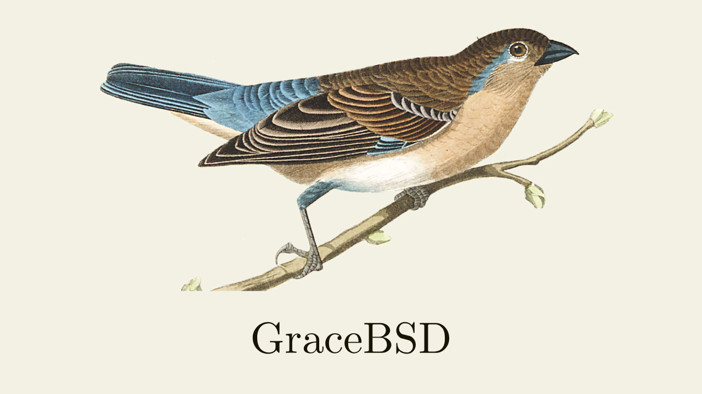

# GraceBSD



A [Unix v6](https://github.com/mit-pdos/xv6-public)-like kernel for a BSD-like operating system built with [CakeML](https://cakeml.org/).
Uses the [Limine](https://github.com/limine-bootloader/limine) bootloader.

## Dependencies

```bash
sudo apt install build-essential git curl wget python3 \
                 xorriso qemu-system-x86 \
                 mtools gdisk nasm clang-format git-lfs
```

## Build

```bash
make
```

## Emulate in QEMU

Boots, shows a splash screen, passes off to [main.cml](kernel/cml/main.cml), then returns to C.

```bash
make run
```

```
[INFO]  Hello, World from GraceBSD!
[DEBUG] Downsampling splash
[DEBUG] Filling framebuffer
[DEBUG] Drawing splash
[DEBUG] Memory map:
[DEBUG]   #  BASE                LENGTH              TYPE
[DEBUG]   0  0x0000000000001000  0x000000000007d000  BOOTLOADER_RECLAIMABLE
[DEBUG]   1  0x000000000007e000  0x0000000000021000  USABLE
[DEBUG]   2  0x000000000009fc00  0x0000000000000400  RESERVED
[DEBUG]   3  0x00000000000f0000  0x0000000000005000  RESERVED
[DEBUG]   4  0x00000000000f5000  0x0000000000001000  RESERVED_MAPPED
[DEBUG]   5  0x00000000000f6000  0x000000000000a000  RESERVED
[DEBUG]   6  0x0000000000100000  0x000000007eedf000  USABLE
[DEBUG]   7  0x000000007efdf000  0x00000000003fc000  EXECUTABLE_AND_MODULES
[DEBUG]   8  0x000000007f3db000  0x00000000006f0000  USABLE
[DEBUG]   9  0x000000007facb000  0x0000000000514000  BOOTLOADER_RECLAIMABLE
[DEBUG]  10  0x000000007ffdf000  0x0000000000001000  RESERVED
[DEBUG]  11  0x000000007ffe0000  0x0000000000003000  RESERVED_MAPPED
[DEBUG]  12  0x000000007ffe3000  0x000000000001d000  RESERVED
[DEBUG]  13  0x00000000b0000000  0x0000000010000000  RESERVED
[DEBUG]  14  0x00000000fd000000  0x0000000000300000  FRAMEBUFFER
[DEBUG]  15  0x00000000fed1c000  0x0000000000004000  RESERVED
[DEBUG]  16  0x00000000fffc0000  0x0000000000040000  RESERVED
[INFO]  Using memory at 0x100000 with length 0x7eedf000
[DEBUG] CakeML: setting up memory
[DEBUG] CakeML: calling cml_main
memmap         print out the memory map
mandelbrot     render the mandelbrot fractal
factorial <n>  compute n!
greet <name>   get greeted
hcf            halt and catch fire
help           show this message
> memmap
0x0000000000001000 | 0x000000000007d000 | BOOTLOADER_RECLAIMABLE
0x000000000007e000 | 0x0000000000021000 | USABLE
0x000000000009fc00 | 0x0000000000000400 | RESERVED
0x00000000000f0000 | 0x0000000000005000 | RESERVED
0x00000000000f5000 | 0x0000000000001000 | RESERVED_MAPPED
0x00000000000f6000 | 0x000000000000a000 | RESERVED
0x0000000000100000 | 0x000000007eedf000 | USABLE
0x000000007efdf000 | 0x00000000003fc000 | EXECUTABLE_AND_MODULES
0x000000007f3db000 | 0x00000000006f0000 | USABLE
0x000000007facb000 | 0x0000000000514000 | BOOTLOADER_RECLAIMABLE
0x000000007ffdf000 | 0x0000000000001000 | RESERVED
0x000000007ffe0000 | 0x0000000000003000 | RESERVED_MAPPED
0x000000007ffe3000 | 0x000000000001d000 | RESERVED
0x00000000b0000000 | 0x0000000010000000 | RESERVED
0x00000000fd000000 | 0x0000000000300000 | FRAMEBUFFER
0x00000000fed1c000 | 0x0000000000004000 | RESERVED
0x00000000fffc0000 | 0x0000000000040000 | RESERVED
> mandelbrot
                                                                                           
                                                                                           
                                                                   @.                      
                                                                    =....                  
                                                                   ..:..                   
                                                                  ..::..                   
                                                               .....@@:....                
                                                               .:=@@@@@:.:.                
                                                               ..@@@@@@@:.                 
                                                               .:@@@@@@@@..                
                                                  .: .-    ......#@@@@@@.... ..       .    
                                                   .=:....:::.@:-@@@@@@@-@:-..-.     .:    
                                                   ..@@@-.=:@@@@@@@@@@@@@@@@@@+....=..#-.  
                                                   .=@@@=@@@@@@@@@@@@@@@@@@@@@@@@.@@@@..   
                                                  ....-@@@@@@@@@@@@@@@@@@@@@@@@@@@@@@=.    
                                               ::-..@@@@@@@@@@@@@@@@@@@@@@@@@@@@@@@-..     
                          .                    .-#@=@@@@@@@@@@@@@@@@@@@@@@@@@@@@@@@@@:.    
                           .                   ..+%@@@@@@@@@@@@@@@@@@@@@@@@@@@@@@@@@@=.=.. 
                           ..  :  .:.         .-@@@@@@@@@@@@@@@@@@@@@@@@@@@@@@@@@@@@@@@@@: 
                            ..::-...::....  ...:@@@@@@@@@@@@@@@@@@@@@@@@@@@@@@@@@@@@@@@:.  
                            ..:@@:=@@@*+::.....%@@@@@@@@@@@@@@@@@@@@@@@@@@@@@@@@@@@@@@@-.  
                           ...:@@@@@@@@@@@:...-@@@@@@@@@@@@@@@@@@@@@@@@@@@@@@@@@@@@@@@@@:. 
                          .:-:@@@@@@@@@@@@@@..-@@@@@@@@@@@@@@@@@@@@@@@@@@@@@@@@@@@@@@@@.   
                     .......:@@@@@@@@@@@@@@@@:@@@@@@@@@@@@@@@@@@@@@@@@@@@@@@@@@@@@@@@@@=   
                      .:...:@@@@@@@@@@@@@@@@@@@@@@@@@@@@@@@@@@@@@@@@@@@@@@@@@@@@@@@@@@.    
                   ....:@@@-@@@@@@@@@@@@@@@@@@@@@@@@@@@@@@@@@@@@@@@@@@@@@@@@@@@@@@@@@.     
 ::...@:+@.:-::::-:@--@@@@@@@@@@@@@@@@@@@@@@@@@@@@@@@@@@@@@@@@@@@@@@@@@@@@@@@@@@@@@..      
                   ....:@@@=@@@@@@@@@@@@@@@@@@@@@@@@@@@@@@@@@@@@@@@@@@@@@@@@@@@@@@@@@.     
                      .:...:@@@@@@@@@@@@@@@@@@@@@@@@@@@@@@@@@@@@@@@@@@@@@@@@@@@@@@@@@@.    
                     .......:@@@@@@@@@@@@@@@@:@@@@@@@@@@@@@@@@@@@@@@@@@@@@@@@@@@@@@@@@@=   
                          .:--@@@@@@@@@@@@@@..-@@@@@@@@@@@@@@@@@@@@@@@@@@@@@@@@@@@@@@@@.   
                           ...:@@@@@@@@@@@:...-@@@@@@@@@@@@@@@@@@@@@@@@@@@@@@@@@@@@@@@@@:. 
                            ..:@@:-*@@@*::.....@@@@@@@@@@@@@@@@@@@@@@@@@@@@@@@@@@@@@@@@:.  
                            ..::-...::....  ...:@@@@@@@@@@@@@@@@@@@@@@@@@@@@@@@@@@@@@@@..  
                           ..  :  .:.         .-@@@@@@@@@@@@@@@@@@@@@@@@@@@@@@@@@@@@@@@@#: 
                           .                   ..:@@@@@@@@@@@@@@@@@@@@@@@@@@@@@@@@@@@@.-.. 
                          .                    .*=@@@@@@@@@@@@@@@@@@@@@@@@@@@@@@@@@@@:.    
                                               +.-..@@@@@@@@@@@@@@@@@@@@@@@@@@@@@@@=..     
                                                  ....-@@@@@@@@@@@@@@@@@@@@@@@@@@@@@@*.    
                                                   .=@@@-@@@@@@@@@@@@@@@@@@@@@@@+.@@@@..   
                                                   ..@@@+.*:@@@@@@@@@@@@@@@@@@@....-..=-.  
                                                   .=:.....::.@:-@@@@@@@-#:=..-.     .-    
                                                  .. .-    ......+@@@@@@.... ..       .    
                                                               .:@@@@@@@+..                
                                                               ..@@@@@@@:.                 
                                                               .:+@@@@@:.:.                
                                                               .....@@-....                
                                                                  ..::..                   
                                                                   ..:..                   
                                                                    -....                  
                                                                   @.                      
                                                                                           
> factorial 5
5! = 120
> greet Charles
Hello, Charles!
> help
memmap         print out the memory map
mandelbrot     render the mandelbrot fractal
factorial <n>  compute n!
greet <name>   get greeted
hcf            halt and catch fire
help           show this message
> hcf
```
