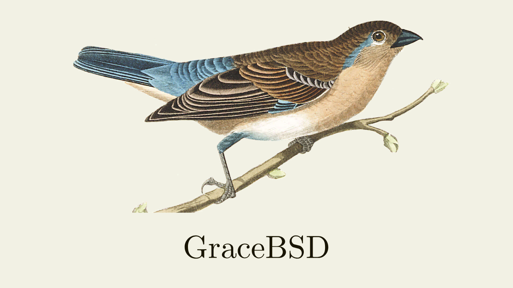

# GraceBSD



A [Unix v6](https://github.com/mit-pdos/xv6-public)-like kernel for a BSD-like operating system built with [CakeML](https://cakeml.org/).
Uses the [Limine](https://github.com/limine-bootloader/limine) bootloader.

## Dependencies

```bash
sudo apt install build-essential git curl wget python3 \
                 xorriso qemu-system-x86 \
                 mtools gdisk nasm clang-format git-lfs
```

## Build

```bash
make
```

## Emulate in QEMU

Boots, shows a splash screen, passes off to [main.cml](kernel/cml/main.cml), then returns to C.

```bash
make run
```

```
[INFO]  Hello, World from GraceBSD!
[DEBUG] Filling framebuffer
[DEBUG] Drawing splash
[DEBUG] Memory map:
[DEBUG]   #  BASE                LENGTH              TYPE
[DEBUG]   0  0x0000000000001000  0x000000000007d000  BOOTLOADER_RECLAIMABLE
[DEBUG]   1  0x000000000007e000  0x0000000000021000  USABLE
[DEBUG]   2  0x000000000009fc00  0x0000000000000400  RESERVED
[DEBUG]   3  0x00000000000f0000  0x0000000000005000  RESERVED
[DEBUG]   4  0x00000000000f5000  0x0000000000001000  RESERVED_MAPPED
[DEBUG]   5  0x00000000000f6000  0x000000000000a000  RESERVED
[DEBUG]   6  0x0000000000100000  0x000000007f6ee000  USABLE
[DEBUG]   7  0x000000007f7ee000  0x0000000000004000  BOOTLOADER_RECLAIMABLE
[DEBUG]   8  0x000000007f7f2000  0x00000000003a3000  EXECUTABLE_AND_MODULES
[DEBUG]   9  0x000000007fb95000  0x00000000003b9000  BOOTLOADER_RECLAIMABLE
[DEBUG]  10  0x000000007ff4e000  0x0000000000014000  USABLE
[DEBUG]  11  0x000000007ff62000  0x000000000007d000  BOOTLOADER_RECLAIMABLE
[DEBUG]  12  0x000000007ffdf000  0x0000000000001000  RESERVED
[DEBUG]  13  0x000000007ffe0000  0x0000000000003000  RESERVED_MAPPED
[DEBUG]  14  0x000000007ffe3000  0x000000000001d000  RESERVED
[DEBUG]  15  0x00000000b0000000  0x0000000010000000  RESERVED
[DEBUG]  16  0x00000000fd000000  0x0000000000384000  FRAMEBUFFER
[DEBUG]  17  0x00000000fed1c000  0x0000000000004000  RESERVED
[DEBUG]  18  0x00000000fffc0000  0x0000000000040000  RESERVED
[INFO]  Using memory at 0x100000 with length 0x7f6ee000
[DEBUG] CakeML: setting up memory
[DEBUG] CakeML: calling cml_main
What's your name? Charles
Hello, Charles
15! = 1307674368000
[INFO]  CakeML: cml_main returned with code 0
[INFO]  Done running CakeML
```
